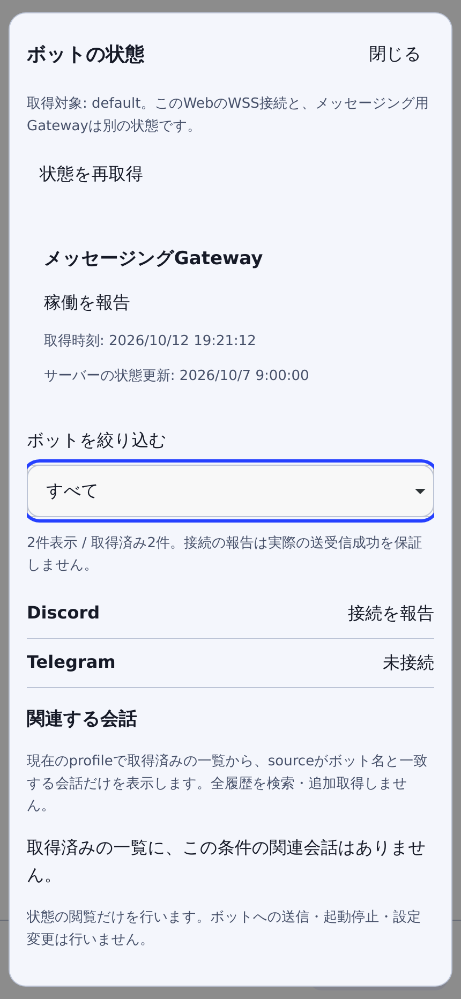
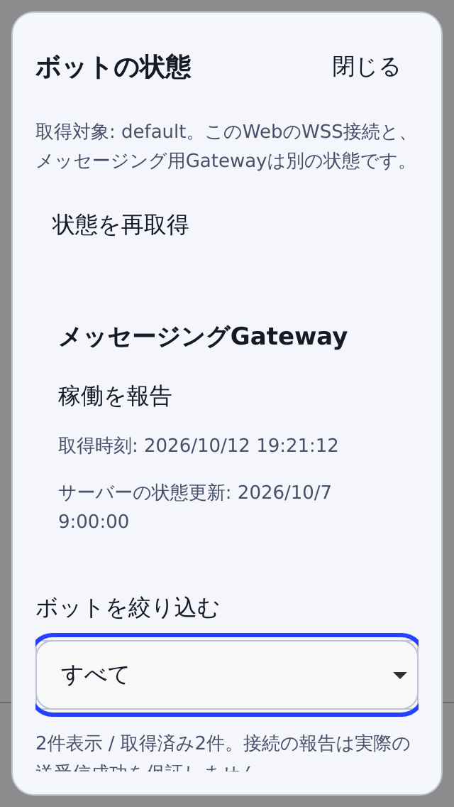

# Existing bot overview

This first bot feature reads the existing Hermes messaging Gateway. It does not
create another bot engine, send a message, change credentials, enable a platform,
start/stop a service or schedule a task.

Open **Settings → ボットの状態を開く**, or choose **ボットの状態** in quick
navigation. Opening performs one authenticated, profile-scoped read. Filtering
uses only the loaded rows; **状態を再取得** is an explicit refresh. Closing stays
available during a read and restores the existing dialog focus chain.

## Meaning of the data

- The Web client's WSS connection and the messaging Gateway are separate states.
- Runtime `connected` is a server report, not a verified end-to-end message exchange.
- Configured/enabled credentials alone are never displayed as connected.
- Missing fields, stale heartbeat, stopped Gateway, failed reads and unsupported
  responses remain explicit. An older read is labelled as previous data.
- A shared Gateway is identified without showing other profiles' names. A scoped
  request never renders another profile's namespaced platform entry.
- Platform display is bounded to 50 rows. Unknown/custom platform names use a
  neutral label; raw errors, credentials, server paths and process IDs are omitted.
- Related conversations are only already-loaded rows whose canonical `source`
  matches a displayed platform. No extra history is fetched to populate this list.
  An empty result is not proof that no bot conversations or configurations exist.
- Opening a related conversation requires an explicit click and the existing
  draft/running/unknown-send guards. Durable/live/lineage identities are retained.

## Existing contract

The fixed backend described in `compatibility.json` implements
`GET /api/status?profile=<registered-name>` with profile-specific runtime status.
The central RemoteController first checks the protected `GET /api/auth/me` flow,
then calls that existing status endpoint on the same origin. A successful public
status response is not a substitute for valid Dashboard authentication.
The entry also requires the existing authenticated principal and registered
profile scope. Servers without that contract remain unavailable with a reason.

Auth/profile/principal/socket changes and close invalidate late replies. Both
reads receive the cancellation signal. A late authentication failure from an old
scope cannot clear a newly selected scope. No retry, API probing, new RPC method,
ownership takeover or silent fallback is added. Older/malformed responses remain
unsupported/unknown/error instead of guessed success.

All feature data and filter selections are memory-only. No storage key, external
telemetry, credential resolver, worker or background service is added. Existing
save/notification/microphone choices are unchanged.

## Qualification

`npm run e2e:bots` uses the built client, actual loopback auth/WSS fixture and a
synthetic response at the existing status URL. It covers explicit reads, filters,
refresh failure, close/reopen with a delayed response, composer draft retention,
modal focus and small/landscape/200%/reduced-viewport layouts in both engines.
The evidence is under `output/bot-overview/`.

Unit tests cover bounded projection, untrusted fields, contradictory/unknown
states, foreign scope, expired auth, cancellation and zero implicit operations.
Real bot send/receive, physical iPhone, paid generation and bot-management writes
are separate acceptance stages and are not established by these tests.

These images are WebKit renders using synthetic runtime data, not real bot or
physical-iPhone captures. The dialog body scrolls while Close stays accessible.

| Bot status at 430px | Narrow 320px viewport |
| --- | --- |
|  |  |

## Following bot slices

1. Extend source-labelled conversation discovery using authoritative owner/profile
   APIs and explicit pagination, without pretending unloaded chats were searched.
2. Add role/profile and automation setup only through real supported Hermes APIs,
   with explicit review, readback, concurrency and unknown-write handling.
3. Qualify a selected messaging platform with a permitted synthetic conversation
   and bounded provider budget. Tokens, allowlists, sends and scheduled execution
   remain explicit operator actions; installation does not enable them.

The Developer Preview/Beta/device gates in `OSS_ROADMAP.md` still apply.
