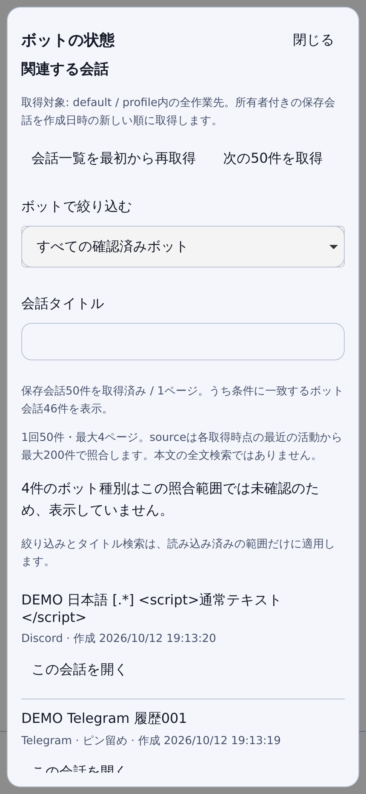
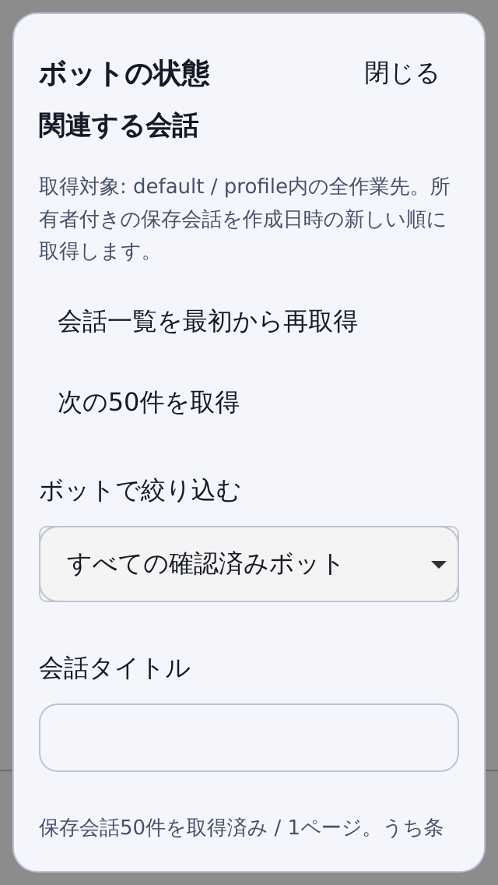

# Existing bot overview

This first bot feature reads the existing Hermes messaging Gateway. It does not
create another bot engine, send a message, change credentials, enable a platform,
start/stop a service or schedule a task.

Open **Settings → ボットの状態を開く**, or choose **ボットの状態** in quick
navigation. Opening performs one authenticated, profile-scoped read. Filtering
uses only the loaded rows; **状態を再取得** is an explicit refresh. Closing stays
available during a read and restores the existing dialog focus chain.

## Meaning of the data

- The Web client's WSS connection and the messaging Gateway are separate states.
- Runtime `connected` is a server report, not a verified end-to-end message exchange.
- Configured/enabled credentials alone are never displayed as connected.
- Missing fields, stale heartbeat, stopped Gateway, failed reads and unsupported
  responses remain explicit. An older read is labelled as previous data.
- A shared Gateway is identified without showing other profiles' names. A scoped
  request never renders another profile's namespaced platform entry.
- Platform display is bounded to 50 rows. Unknown/custom platform names use a
  neutral label; raw errors, credentials, server paths and process IDs are omitted.
- Related conversations initially use the already-loaded source-labelled rows.
  **会話一覧を取得** explicitly loads an owned page; **次の50件を取得** loads one
  further page. Opening/filtering the panel does not fetch additional history.
  An empty result is not proof that no bot conversations or configurations exist.
- Opening a related conversation requires an explicit click and the existing
  draft/running/unknown-send guards. Durable/live/lineage identities are retained.

## Existing contract

The fixed backend described in `compatibility.json` implements
`GET /api/status?profile=<registered-name>` with profile-specific runtime status.
The central RemoteController first checks the protected `GET /api/auth/me` flow,
then calls that existing status endpoint on the same origin. A successful public
status response is not a substitute for valid Dashboard authentication.
The entry also requires the existing authenticated principal and registered
profile scope. Servers without that contract remain unavailable with a reason.

Auth/profile/principal/socket changes and close invalidate late replies. Both
reads receive the cancellation signal. A late authentication failure from an old
scope cannot clear a newly selected scope. No retry, API probing, new RPC method,
ownership takeover or silent fallback is added. Older/malformed responses remain
unsupported/unknown/error instead of guessed success.

All feature data and filter selections are memory-only. No storage key, external
telemetry, credential resolver, worker or background service is added. Existing
save/notification/microphone choices are unchanged.

## Bot conversation discovery

The history section works independently of a stopped/missing messaging Gateway
status report. Use **会話のボットを選ぶ** and the title search to filter the loaded
range, then explicitly open a row. Search is literal text, not a regular
expression or full-text/whole-history query. The selected registered project is
an additional read scope; it never changes the default working directory.

Each page performs native auth verification, then two existing bounded reads:

1. `remote.sessions.list`: selected profile, optional selected registered
   `project_id`, `limit: 50` and the returned opaque cursor on subsequent pages.
   Its `owned_profile_sessions` scope is authoritative for identities/titles.
2. Official `session.list`: the same profile and `limit: 200`. Only its exact-ID
   `source` evidence for rows in the owned page is retained. Other IDs, raw titles,
   previews, aliases, paths and metadata are discarded.

The fixed owned-page contract has no `source` field/filter. The official source
index has no cursor, source or offset parameter. No unsupported parameter is sent,
and no title lookup, hidden-history query or REST auto-archive endpoint is used.
An alias or matching title is not identity evidence. A missing/conflicting source
remains unknown; a non-bot source is not relabelled as a bot. Recognized historical
bot sources can be browsed even if their Gateway is currently stopped.

Reads stop at four manually requested pages (at most 200 owned rows). The source
index is only the most recent 200 visible sessions at each read, so older owned
rows may remain unclassified. Counts describe loaded owned rows, matched bot rows
and unclassified rows separately. Reaching the end of an owned page sequence does
not establish complete bot history. A changed snapshot/cyclic cursor is rejected;
failed reads retain clearly labelled stale, non-navigable data until an explicit
first-page refresh succeeds. There is no automatic pagination, retry or polling.

Close, logout, origin/principal/profile/project/socket or session-scope changes
discard results, queries and cursors and cancel local pending reads. Cancellation
does not send a server write/cancel request. Stale callbacks cannot start a read
or open a row in a new scope. Reads do not replace the main list, move the current
conversation or change its memory draft. Existing draft/attachment/running/request/
unknown-send guards still block opening another conversation.

## Qualification

`npm run e2e:bots` uses the built client, actual loopback auth/WSS fixture and a
synthetic response at the existing status URL. It covers explicit reads, filters,
refresh failure, close/reopen with a delayed response, composer draft retention,
modal focus and small/landscape/200%/reduced-viewport layouts in both engines.
The evidence is under `output/bot-overview/`. `npm run e2e:bot-conversations`
additionally covers exact owned/source joins, four explicit pages, literal title
filters, stale/late replies, project/profile isolation, draft preservation,
explicit resume and responsive focus/tap/font bounds in both engines. Evidence
is under `output/bot-conversations/`; all data is synthetic and writes/generation
remain zero except an explicitly requested fixture resume.

Unit tests cover bounded projection, untrusted fields, contradictory/unknown
states, foreign scope, expired auth, cancellation and zero implicit operations.
Real bot send/receive, physical iPhone, paid generation and bot-management writes
are separate acceptance stages and are not established by these tests.

These images are WebKit renders using synthetic runtime data, not real bot or
physical-iPhone captures. The dialog body scrolls while Close stays accessible.

| Bot status at 430px | Narrow 320px viewport |
| --- | --- |
|  |  |

| Explicit owned page and filters at 430px | Narrow bot history at 320px |
| --- | --- |
|  |  |

## Following bot slices

1. Qualify the existing owned-page/source join on an explicitly permitted live
   bot test scope. Browser/contract fixtures are not that live acceptance.
2. Add role/profile and automation setup only through real supported Hermes APIs,
   with explicit review, readback, concurrency and unknown-write handling.
3. Qualify a selected messaging platform with a permitted synthetic conversation
   and bounded provider budget. Tokens, allowlists, sends and scheduled execution
   remain explicit operator actions; installation does not enable them.

The Developer Preview/Beta/device gates in `OSS_ROADMAP.md` still apply.
