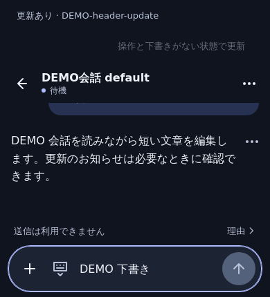
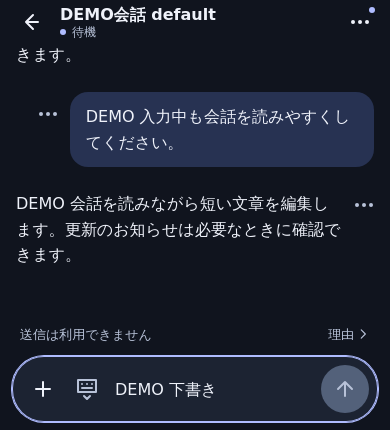

# Compact conversation header

Optional update notices no longer take a separate vertical banner above a conversation. A small indicator on the existing menu exposes an explicit update dialog. The current title, back action, connection/execution status, and menu remain visible. The header is 48 CSS px normally and 44 px with the software keyboard; controls remain at least 44 px. Important synchronization, delivery and execution warnings remain visible.

The update dialog reuses the original guarded update operation, including its late safety check and worker coordination. Drafts, runs, unknown writes and unanswered requests still prevent update. Escape/close restores focus and reading position. Scope/auth changes close the dialog. No new persistence, RPC, automatic reload or backend behavior is added.

Matched synthetic WebKit comparison at width 390 px and visual viewport 430 px: update banner 92.8 px → 0 px; header 56 px → 44 px; transcript 159.2 px → 264 px. These are browser measurements with synthetic content, not physical iPhone acceptance.

| Before | After |
| --- | --- |
|  |  |

`npm run e2e:chat-header` checks WebKit/Chromium, 320/390/430 px, landscape, light/dark, 200% text, simulated keyboard, update guards, focus/read-position restoration and zero prompt/approval/stop/new-session writes. Existing update/rollback tests exercise running and unanswered-request guards through the new menu as well as older banner clients.
