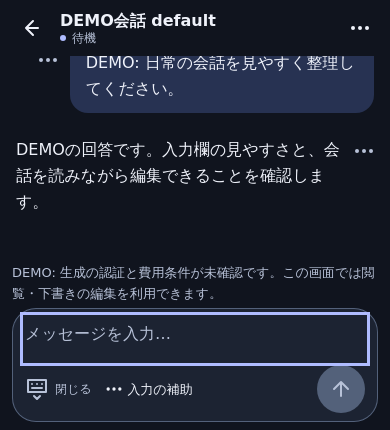
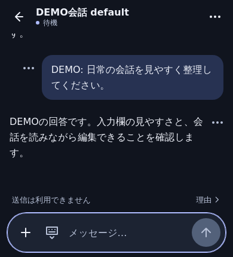
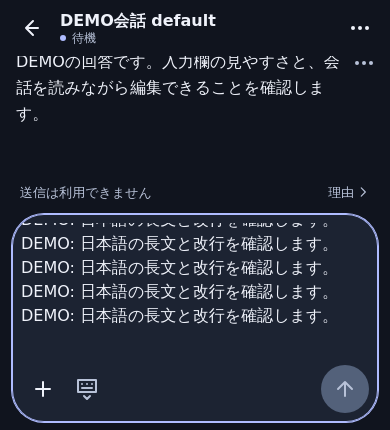

# Compact conversation composer

The composer keeps short messages and controls in one rounded row. The **＋**
button opens the existing input helpers; the keyboard icon closes editing without
clearing the draft. Wrapped text or a line break moves the editor above the
controls at full width, with bounded growth and internal scrolling. Typing at the
end keeps the caret visible; resizing preserves an existing editor scroll position.

There is one visible focus treatment on the rounded container. Other controls
retain their keyboard focus indicators. Inputs remain at least 16px, targets at
least 44px and send at least 48px. Text enlargement uses a full-width editor rather
than reducing font size or disabling zoom. Enter/IME never becomes an implicit send.

A disabled generation policy is presented compactly with **理由**. The explanation
uses the existing modal/focus handling and the unchanged server reason. During
conversation search, the same control is in the bounded search panel, avoiding an
extra composer status row. Closing it changes neither permission nor the draft.
Focus changes alone do not change the short/long row mode, keeping transcript tap targets stationary. Unknown sends, request responses, stop, attachment and Web Lock guards are unchanged.

## Matched synthetic comparison

These screenshots are DEMO-only WebKit 26.5 at 390×844, with a simulated 430px
visual viewport. They are not physical iPhone or paid-provider acceptance.
The same loaded conversation and theme are used on both sides.

| Measurement | Before | After |
| --- | ---: | ---: |
| Short composer height | 114px | 66px |
| Available transcript height | 198.41px | 252px |
| Send target | 48×48px | 48×48px |
| Input font | 16px | 16px |

Before: `remote-v2-9441f8f1df2e5a7a`. After: `remote-v2-e78cd58146d6cbf5`.

## Repeatable checks

`npm run e2e:composer` uses the real built UI, fixed Chromium/WebKit and the
owned local synthetic transport. Reports/screenshots are under
`output/playwright/composer/after/`; `--before` captures a selected baseline build.
It checks 320/390/430px, landscape, light/dark, 200% text, simulated keyboard,
full-width long input and short-input reset, touch hit testing, reason modal,
shared expanded draft/focus, IME, keyboard close and zero operation writes.
Existing chat/daily/search/quote/sidebar/unknown-send/request/stop/update/rollback
regressions remain independent canonical checks.

Real iPhone Safari and home-screen typing/keyboard recovery are NOT_RUN for this
release. The user-provided screenshot establishes the original problem, not the
new release's device acceptance. Production static/read-RPC receipts are private
operations artifacts and are not included in the public source package.
