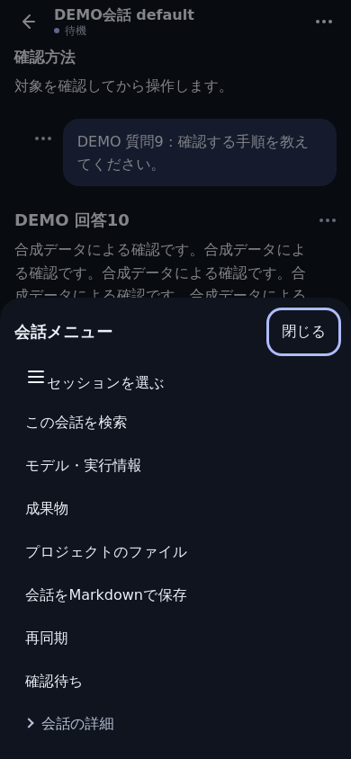
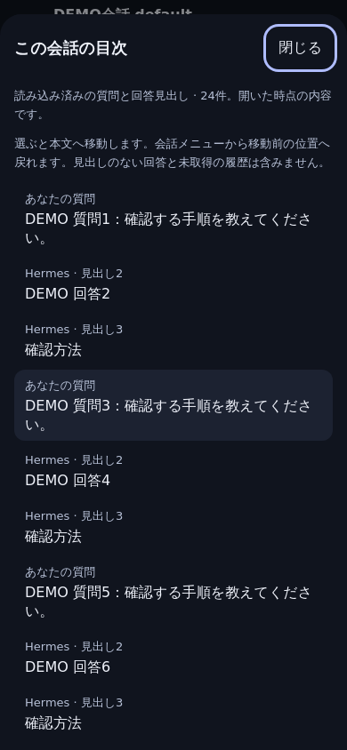
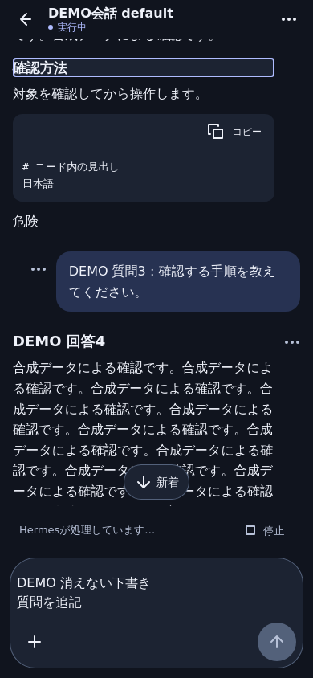

# Loaded conversation outline

Open the conversation menu (…), then **この会話の目次**. Select a question
excerpt or an assistant Markdown heading to jump within the transcript. The
target receives keyboard focus without moving the page and a brief visual outline.
Open the conversation menu again and choose **移動前の位置へ戻る** to return
to the first jump's reading anchor. Further jumps retain that original anchor.

The sheet is a memory-only snapshot at opening. It includes user questions and
assistant Markdown headings, in their existing order. It excludes tool/system
messages, Markdown code-fence contents, raw HTML and non-heading assistant prose.
A heading changed or removed after opening is refused; reopen the outline for a
fresh snapshot. No history is fetched, no summary generated and no API/RPC is
called by outline actions. Existing event-completion/reconnect reads still apply.

Bounds match the displayed message window: latest 400 messages, at most 80,000
source characters per message, 500,000 source characters total and 200 entries.
Truncation is stated. Labels are plain React text, at most 120 Unicode code points
plus an ellipsis. Duplicate headings are located by their message and ordinal;
untrusted labels/IDs are never interpolated into selectors or HTML.

Opening or closing preserves the current draft, search and reader position.
Streaming cannot reorder the open snapshot. Explicit jumps do not follow new
output to the bottom. Search highlighting and code-copy content remain intact.
The return anchor uses the existing message-relative scroll helper; if history
has since been removed or reflowed, returning is best effort within the currently
displayed transcript. Session/profile/auth teardown discards outline state.
Nothing is persisted to storage, URL, analytics or the server.

## Acceptance

- Unit: bounded Markdown extraction, HTML/URL safety, duplicate/changed/missing
  targets, stream snapshot, draft/search preservation, scope/auth teardown,
  return focus and zero operation/storage writes.
- `npm run e2e:conversation-outline`: Chromium and WebKit, real browser layout
  with synthetic conversations/events; exact jump/return geometry, page scroll,
  stream arrivals, search marks, code copy, zero extra RPC, 320/390/430 widths,
  landscape, simulated keyboard, light/dark and 200% text.
- Existing conversation, quote/attachment, sidebar, update/rollback, worker and
  privacy suites remain required. Dependency/backend/runtime contracts unchanged.
- Physical iPhone Safari/home-screen and real provider generation are separate
  acceptance stages, not established by these synthetic browser tests.

## Synthetic browser comparison

Same 390 × 844 WebKit viewport, synthetic Japanese conversation and memory draft.
These are browser-engine screenshots, not physical iPhone acceptance.

| Before: conversation menu | After: loaded outline | After: explicit heading jump |
| --- | --- | --- |
|  |  |  |
