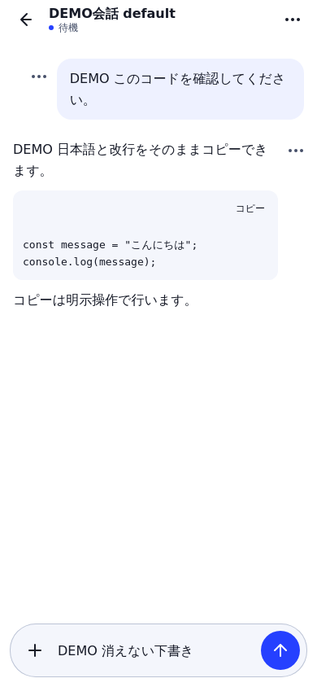
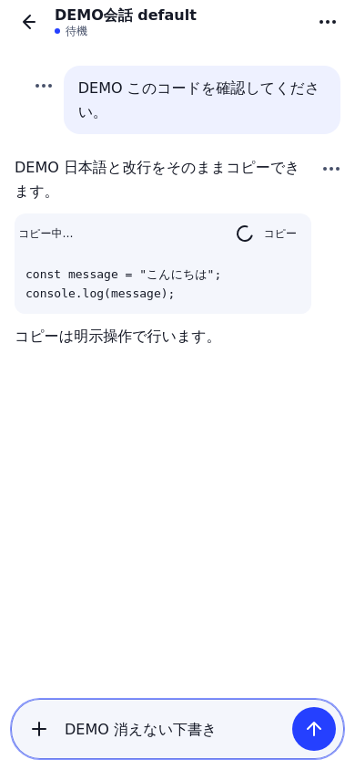
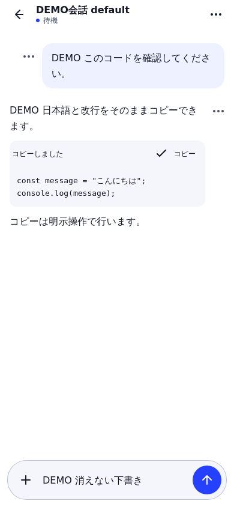
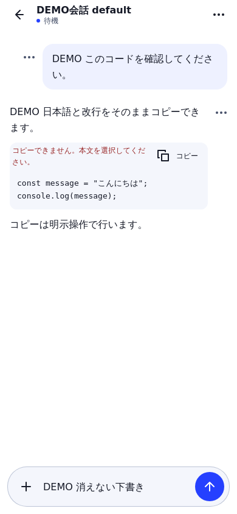

# Micro-interaction refinement

Shared controls provide brief press/focus feedback without scaling or moving the
hit target. Hover feedback only applies to fine pointers with hover capability.
Native dialogs use a 140 ms opacity-only entrance; closing, cancellation and focus
restoration stay immediate. There is no per-token message animation or automatic
scroll. OS reduced-motion preference disables animation/transition for elements,
pseudo-elements and progress icons.

Code and message copy share an explicit, memory-only clipboard controller. Pending
writes are coalesced even across menu dismissal/reopening. Success appears only
when the browser clipboard promise settles and expires after 2.2 seconds. Failure
remains visible with manual text-selection guidance. A late callback cannot show
success in another message/scope. Copy buttons remain focusable while busy, keep
their geometry and expose busy/disabled state to assistive technology. No automatic
clipboard write/retry, persistence or new API request is introduced.

Send, session/list/project loading and update checks use progress icons driven by
existing operation state. Existing delivery-unknown and execution states remain
separate. Message/composer menu triggers expose expanded state. Clearing the loaded
conversation-title search returns focus to its input without scrolling or losing
the conversation draft.

## Matched synthetic browser comparison

These images use the same synthetic content and 390 × 844 viewport. They are not
physical-iPhone, provider or real-conversation evidence. Pending and confirmed
states are deliberately separate.

| Previously no pending feedback | Pending clipboard operation |
| --- | --- |
|  |  |

| Confirmed clipboard operation | Explicit failure |
| --- | --- |
|  |  |

`npm run e2e:micro-interactions` exercises Chromium and WebKit, including duplicate
taps, scoped late callbacks, exact copied code, focus/draft continuity, dialog and
backdrop reduced motion, 320/390/430 widths, landscape, light/dark and 200% text.
It asserts zero prompt, approval, interrupt and new-session operations. Existing
composer, chat-header, daily UI, sidebar, update/rollback and full interaction
suites remain required. Physical iPhone/Safari/home-screen acceptance is separate.

No Core, runtime, backend, dependency-lock, authentication, worker, consent or
storage contract changes are part of this refinement.
